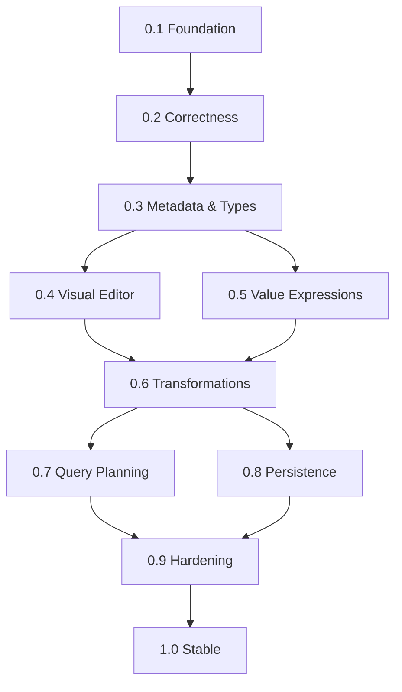

# ExpressionForge Roadmap

ExpressionForge is a metadata-driven expression and query engine with a visual editor. The canonical recursive JSON AST is independent of the editor and SQL Server.

## Development principles

- Work on feature branches; merge only after build/test checks and review.
- Increment the visible product/package version only after a milestone's acceptance criteria are met.
- Every new operation needs metadata, validation, compilation, and tests.
- Keep v1 read-only: data mutation and side-effecting workflows are out of scope.
- Preserve JSON contract compatibility or provide explicit migrations.

## Milestones

| Version | Focus | Exit criteria |
| --- | --- | --- |
| 0.1.0 | Initial foundation | AST, sample metadata, validation, SQL Server compiler, basic editor (implemented; runtime verification ongoing) |
| 0.2.0 | Expression correctness | Stable node identity, structured diagnostics, null/type/quantifier semantics, runtime parameters, SQL Server integration tests, CI green |
| 0.3.0 | Dynamic metadata & types | Register entities/operators without frontend changes; typed scope resolution, versioning and permissions |
| 0.4.0 | Blueprint editor | Free-form canvas, typed sockets, drag/drop, undo/redo, AST round-trip |
| 0.5.0 | Value expressions | Arithmetic, field-to-field comparisons, string/date functions, explicit conversions |
| 0.6.0 | Query transformations | Projection, sorting, joins, grouping, aggregation, output-schema inference |
| 0.7.0 | Query planning | Provider-neutral logical plan, optimizer, explain API and semantic-equivalence tests |
| 0.8.0 | Persistence & reuse | Saved/versioned definitions, reusable expressions, parameter templates and migrations |
| 0.9.0 | Production hardening | Provider abstraction and second provider, tenant/field authorization, budgets, telemetry, load/security tests |
| 1.0.0 | Stable release | Documented public contracts, packages, complete sample, compatibility policy, clean installation and production checklist |

## Current work: v0.2.0

**Integration strategy:** Small, independently tested PRs merge into `main`. The version remains 0.1.0 until all v0.2.0 exit criteria are satisfied.

Completed increments:
- Stable optional expression node IDs and structured validation diagnostics, compatible with existing JSON v1.
- Typed runtime parameter references and bound validation/compile/preview API endpoints.
- Metadata-driven editor runtime parameter inspector, with nested collection scoping and client-side binding tests.
- .NET 10 CI with MSTest, editor tests and build artifacts; verified green on `main`.

Remaining before a v0.2.0 release: SQL Server integration tests (Testcontainers) for null/type/quantifier semantics, plus final acceptance and release verification.

## Dependencies

