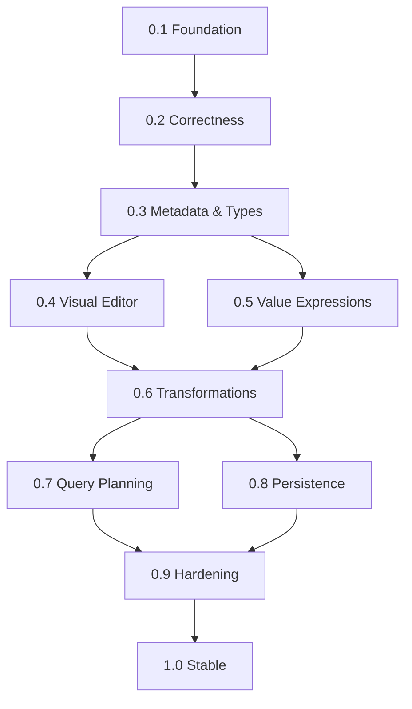

# ExpressionForge Roadmap

ExpressionForge is a metadata-driven expression and query engine with a visual editor. The canonical recursive JSON AST is independent of the editor and SQL Server.

## Development principles

- Work on feature branches; merge only after build/test checks and review.
- Increment the visible product/package version only after a milestone's acceptance criteria are met.
- Every new operation needs metadata, validation, compilation, and tests.
- Keep v1 read-only: data mutation and side-effecting workflows are out of scope.
- Preserve JSON contract compatibility or provide explicit migrations.

## Milestones

| Version | Focus | Exit criteria |
| --- | --- | --- |
| 0.1.0 | Initial foundation | AST, sample metadata, validation, SQL Server compiler, basic editor (implemented; runtime verification ongoing) |
| 0.2.0 | Expression correctness | Stable node identity, structured diagnostics, null/type/quantifier semantics, runtime parameters, SQL Server integration tests, CI green |
| 0.3.0 | Dynamic metadata & types | Register entities/operators without frontend changes; typed scope resolution, versioning and permissions |
| 0.4.0 | Blueprint editor | Free-form canvas, typed sockets, drag/drop, undo/redo, AST round-trip |
| 0.5.0 | Value expressions | Arithmetic, field-to-field comparisons, string/date functions, explicit conversions |
| 0.6.0 | Query transformations | Projection, sorting, joins, grouping, aggregation, output-schema inference |
| 0.7.0 | Query planning | Provider-neutral logical plan, optimizer, explain API and semantic-equivalence tests |
| 0.8.0 | Persistence & reuse | Saved/versioned definitions, reusable expressions, parameter templates and migrations |
| 0.9.0 | Production hardening | Provider abstraction and second provider, tenant/field authorization, budgets, telemetry, load/security tests |
| 1.0.0 | Stable release | Documented public contracts, packages, complete sample, compatibility policy, clean installation and production checklist |

## v0.2.0 — acceptance and release

**Integration strategy:** Small, independently tested PRs merge into `main`. The v0.2.0 package and metadata catalog versions are aligned; the release workflow verifies all tests and artifacts before publishing.

Completed increments:
- Stable optional expression node IDs and structured validation diagnostics, compatible with existing JSON v1.
- Typed runtime parameter references and bound validation/compile/preview API endpoints.
- Metadata-driven editor runtime parameter inspector, with nested collection scoping and client-side binding tests.
- .NET 10 CI with MSTest, editor tests and build artifacts; verified green on `main`.

Completed: SQL Server 2022 Testcontainers coverage for null/type/quantifier semantics and real database execution. The public GitHub Pages site now shares five complex AST fixtures with unit and SQL Server integration tests, so documented examples cannot drift silently from the engine.

Final correctness review is complete, including diagnostic ownership, cross-type parameter conflicts and invalid null-check values. The v0.2.0 release is published only after the automated release workflow verifies the merged version bump and creates the GitHub Release. Dynamic metadata and type registration belong to v0.3.0.

## Next work: v0.3.0

**Increment 1 — registered catalogs:** Add a validated `QueryCatalogBuilder`, trusted JSON catalog loading, and API configuration to replace the built-in demo with any supported entity schema. Validate operator compatibility, SQL mapping identifiers, relationship target/key types and read-only catalog snapshots. Include a Project/Task example on the website, compiler tests, and a real SQL Server 2022 execution test. The existing frontend discovers the new metadata through the same endpoint.

**Increment 2 — catalog revisions and typed scopes:** A deterministic fingerprint detects changes in catalog mappings, data types and operators. Persisted AST v1 queries may pin an optional revision and receive structured rejection when it is stale. A typed-scope API resolves each nested expression's active entity, property types and allowed collections without runtime values or physical SQL mappings. See [catalog revisions and scopes](catalog-revisions-and-scopes.md).

**Increment 3 — authorization-aware discovery and enforcement:** Trusted role grants restrict entities, fields and relationships consistently across metadata discovery, nested scope resolution, semantic validation, SQL SELECT projections, bound execution and preview. Protected deployments use JWT bearer authentication; a real SQL Server 2022 test verifies returned columns. See [authorization and role grants](authorization.md).

**Increment 4 — multiple catalog providers and editor switching:** Register multiple named domain catalogs through a trusted manifest and pluggable `IQueryCatalogSource` implementations. Route AST v1 definitions via optional `catalogId`, preserve isolated editor drafts, offer scoped discovery, and reject mixed public/protected configurations. Preserve legacy default-catalog queries. See [catalog registry](catalog-registry.md).

**Release assessment:** After green .NET, editor, site and SQL Server checks, review the complete 0.3.0 acceptance criteria and prepare its independently verified release. Arbitrary SQL operators, live database introspection and hot reload remain out of scope. Keep the [GitHub Pages examples](https://matrtech.github.io/ExpressionForge/#examples) verified. Keep the [GitHub Pages example gallery](https://matrtech.github.io/ExpressionForge/#examples) updated with examples that are also exercised by .NET and SQL Server tests.

## v0.5.0 — Value expressions (incremental delivery)

**Increment 1 — metadata-safe field comparisons:** Add the `fieldComparison` predicate to JSON AST v1, with `leftField`, `operator`, and `rightField`. Both fields are resolved within the same (possibly nested collection) entity scope using the trusted catalog. The validator enforces identical types and approved operators; SQL Server emits validated quoted columns, not user-provided SQL. No runtime binding is required. Scope discovery, Guided and Blueprint editors, graph round-trip and real SQL Server tests cover this increment.

Example:

```json
{
  "version": 1,
  "entity": "Customer",
  "query": {
    "type": "collectionExpression",
    "collection": "Orders",
    "quantifier": "any",
    "expression": {
      "type": "fieldComparison",
      "leftField": "Id",
      "operator": "greaterThan",
      "rightField": "CustomerId"
    }
  }
}
```

**Increment 2 — composable numeric arithmetic:** Added `arithmeticComparison` with nested `numericField`, `numericLiteral`, and `numericBinary` values. Comparisons support numeric equality and ordering; arithmetic supports `add`, `subtract`, `multiply`. Each numeric value uses `decimal(28,6)` SQL semantics and follows trusted catalog scoping. The backend restricts literal precision/range and enforces shared expression complexity limits. Guided and Blueprint editors offer a simple field-operation-operand-threshold form; advanced nested arithmetic works through JSON. Unit, browser and real SQL Server tests cover nested values and root/collection scopes.

**Increment 3 — safe division and runtime numeric parameters:** `numericBinary.operator=divide` compiles the denominator using SQL Server `NULLIF(..., 0)`, so division by zero yields `NULL`, never a divide-by-zero exception. As with other SQL three-valued comparisons, UNKNOWN does not select a row. `numericParameter` references a separately supplied, named decimal binding; the numeric value is strictly validated (±1e12, up to six decimal places), and names participate in shared parameter-type conflict checks. The Guided and Blueprint calculation controls can switch the operand and threshold between literal and runtime parameter, and the existing bindings panel discovers nested parameters in collection scopes. Unit, editor, browser and real SQL Server 2022 coverage include literal and runtime zero divisors and incompatible bindings.

**Increment 4 — typed string/date functions:** Added `stringLength` and `dateDiffDays` numeric-value nodes, composable in the existing numeric tree. String length follows SQL Server `LEN` semantics; date differences count signed calendar-day boundaries between fields of matching date/dateTime types. Missing, inaccessible, or wrong-type fields are rejected before SQL generation, including in nested collection scopes. Both functions preserve NULL semantics, and the existing 16-level/256-node budgets apply. Guided/Blueprint expose common field-and-threshold controls. Unit, real SQL Server, editor and Chromium tests cover these behaviors.

**Increment 5 — explicit decimal conversion and composable value editing:** The new `tryParseDecimal` numeric-value node safely converts an approved string field using `TRY_CONVERT(decimal(28,6), column)`. Invalid/NULL text and overflow yield NULL; no user SQL or unregistered identifiers are allowed. Guided and Blueprint can create simple conversion predicates. Blueprint's advanced value-tree inspector supports typed replacement, adding/wrapping arithmetic, changing field/parameter/number inputs, and unwrapping composed expressions. The edit operations work on a single immutable canonical AST and check metadata and numeric restrictions. Node, .NET unit, Chromium, and real SQL Server 2022 tests cover typed scopes, nested expressions, NULL/invalid conversions and undo.

This is a development increment, **not a package release**. Next: explicit conversions for more value types, richer visual value sockets, provider-neutral conversion semantics, and overflow-policy hardening.

## Dependencies


