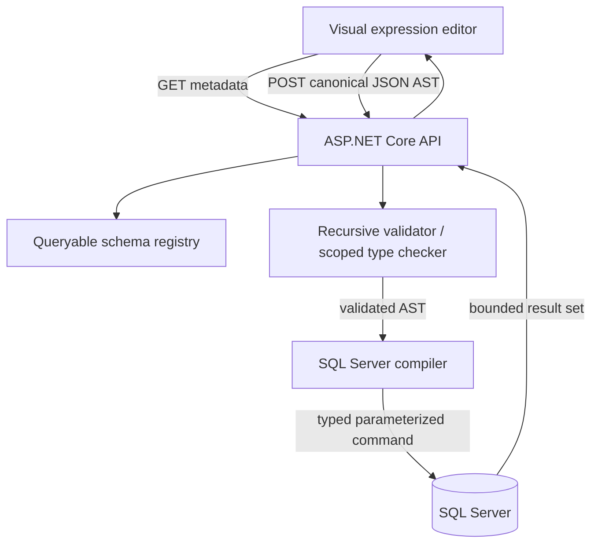

# ExpressionForge architecture — v0.1.0

## Runtime flow

### Contracts

- **Schema catalog:** explicitly registered entity fields and relationship IDs. SQL table names and relationship join keys are internal-only and excluded from metadata JSON.
- **Expression AST:** JSON polymorphism (`type` discriminators) supports comparison, boolean group, negation and collection quantifiers.
- **Validation:** checks AST version, root entity, registered fields, operator compatibility, scalar JSON value types, valid relationship contexts, max nodes and max depth.
- **SQL compilation:** converts a validated AST into a single `SELECT TOP (@take)` statement with parameterized scalar values, correlated `EXISTS`, `NOT EXISTS`, grouped logical operators and escaped LIKE patterns.
- **Preview execution:** optional SQL Server connection, short command timeout, max 100 rows, strongly typed output column definitions.

### Semantics

`CollectionExpression` changes the current scope to its relationship target. Comparison field IDs always resolve **inside the current scope**. A related collection is not a logical `GroupExpression`; groups combine conditions on one entity, collections quantify conditions over related records.

`Any(predicate)` compiles to `EXISTS(child WHERE correlation AND predicate)`; `None` compiles to `NOT EXISTS(child WHERE correlation AND predicate)`; `All` compiles to `NOT EXISTS(child WHERE correlation AND predicate IS NOT TRUE)`, implemented with `CASE WHEN ... THEN 1 ELSE 0 END = 0` for SQL Server 3-valued logic.

### Stable identifiers and metadata

Saved expressions use stable identifiers (`Customer`, `FirstName`, `Orders`) rather than localized display names. The catalog contract includes a version for clients to detect changes. More advanced schema evolution and migrations are intentionally deferred.

### Future architecture

For transformations (select, project, aggregate, group, join), don't stretch boolean expression nodes into query pipeline nodes. Introduce separate **value expressions** and a **logical query plan** (Source, Filter, Project, Aggregate, Sort, Limit). Infer output schemas at each stage and compile optimized provider-specific physical plans.

A future free-form graph editor should store viewport coordinates and edges separately from the AST; visual decorations should not affect execution semantics. Backend validation is authoritative regardless of the UI.

### Production security boundary

The demonstration does **not** provide authentication, per-user authorization or tenant isolation. Those need to sit ahead of metadata discovery and compiler usage in a production host. Least-privilege read-only database credentials, bounded request payload sizes, rate limits, network isolation, cancellation and telemetry are also required for production deployments. Never expose connection strings to the browser or allow arbitrary table/column names in client-defined expressions.
